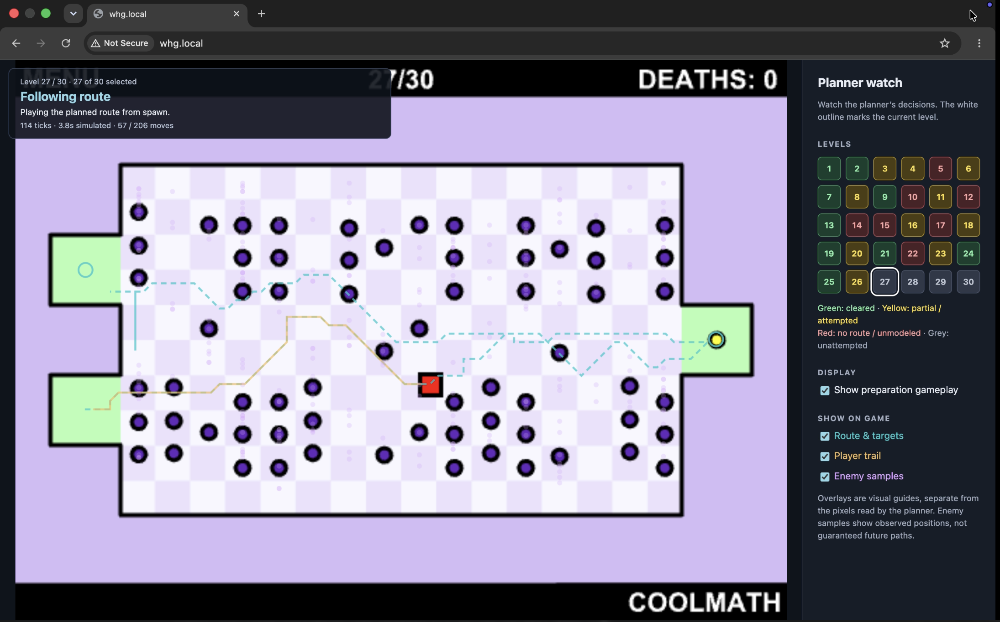

# Training with the original SWF

The environment runs `WHGOriginal.swf` in a hidden Chromium, Google Chrome, or Microsoft Edge session using Ruffle Web. It advances a virtual browser clock at the game's native 30 fps and lets the original SWF handle movement, collisions, and level progression.



## First-time setup (macOS and Windows)

Use Python 3.10+ and run commands from the project folder. The original
`WHGOriginal.swf` must remain in that folder. Use a virtual environment if desired,
and install dependencies into the same Python interpreter used to run the scripts.

On macOS:

```sh
python3 -m pip install -r requirements-training.txt
python3 -m playwright install chromium
```

On Windows (PowerShell):

```powershell
python -m pip install -r requirements-training.txt
python -m playwright install chromium
```

Examples below use `python`; on macOS substitute `python3` if that is your Python
command. Playwright's Chromium installation is separate from installing the Python
package. If you only want to use an already installed Chrome or Edge, you can skip
`playwright install chromium` and pass the corresponding `--browser` option.

### Install Ruffle Web

The project needs Ruffle's **self-hosted web package**, not the desktop application
or browser extension. You do not need to open the SWF manually: the scripts serve
and load it automatically, without a separate web server.

The build tested here is `@ruffle-rs/ruffle` **0.7.1**. Use the same build on machines
whose results you want to compare. That version is available as a
[package archive](https://registry.npmjs.org/@ruffle-rs/ruffle/-/ruffle-0.7.1.tgz).
Alternatively, obtain a self-hosted build from [Ruffle downloads](https://ruffle.rs/downloads.html);
a different build may change rendering or gameplay behavior and needs validation.

Extract the archive and place the files in this layout, relative to the project
folder (the archive may already contain the `package` directory):

```text
worlds-hardest-game/
    WHGOriginal.swf
    training_env.py
    benchmark_levels.py
    ruffle-web/
        package/
            ruffle.js
            core.ruffle.<build-hash>.js
            <build-hash>.wasm
            ...other files from the same Ruffle package...
```

`ruffle.js` must be directly inside `ruffle-web/package`, not in another nested
`package` folder. Keep all accompanying JavaScript and WASM files together; do not
mix files from different builds. `ruffle-web/` is ignored by Git, so each teammate
must install it locally.

`training_env.py`, `evolve.py`, and `reactive.py` also support a custom location:

```sh
python training_env.py --browser chrome --ruffle-dir "/path/to/ruffle-files" --runs 3
```

On Windows, use a path such as `"C:\path\to\ruffle-files"`. The folder must contain
`ruffle.js`. `plan_level1.py` and `benchmark_levels.py` currently require the default
`ruffle-web/package` location.

### Choose a browser

The browser commands (`training_env.py`, `evolve.py`, `reactive.py`,
`evolve_planner.py`, `plan_level1.py`, and `benchmark_levels.py`) accept `--browser chromium|chrome|edge`.
The default is now Playwright's bundled **Chromium**; older versions of this project
always launched Edge. Chrome and Edge must already be installed when selected.

```sh
python training_env.py --browser chrome --runs 3
python evolve.py --browser chrome --watch best_replay.json
python benchmark_levels.py --browser edge --watch
```

Each run prints the browser name and version. A missing browser produces installation
guidance; the program does not silently choose a different browser. On your existing
Windows setup, pass `--browser edge` to keep using Edge without installing Chromium.

## Verify the setup and run the benchmark

Start with a short reset/replay test, then check a subset of the level benchmark:

```sh
python training_env.py --runs 3
python training_env.py --direct-reset --runs 3
python benchmark_levels.py --levels 1 2 13 --output local-check.json
python benchmark_levels.py --watch --levels 1 2 13
```

Append `--browser chrome` or `--browser edge` to each command as appropriate.
`local-check.json` is a separate local result file so this check does not overwrite
the committed `level_benchmark.json`. Watch mode does not save results unless you
supply `--output`.

Then run the full level benchmark, or a longer throughput test:

```sh
python benchmark_levels.py --watch
python training_env.py --runs 10
python training_env.py --level 30 --runs 3
```

`benchmark_levels.py` uses built-in route planners and does **not** load the output
of `evolve.py` or `reactive.py`. No training step is required before benchmarking.
Those training commands are separate experiments described below.

### Troubleshooting and comparing machines

- **Missing `ruffle-web/package`:** install the self-hosted web files in the layout
  above. Installing the desktop app alone is insufficient.
- **Missing browser executable:** run `python -m playwright install chromium`, or
  select an installed browser with `--browser chrome` or `--browser edge`.
- **Reset did not reach gameplay:** save the startup screen with
  `python training_env.py --browser chrome --inspect training-preview.png`.
  For a direct-start failure, include `--direct-reset` as well. Verify the Ruffle
  build and that the window shows the actual game.
- **Watch mode on Retina/high-DPI displays:** the game now renders at a fixed
  550 × 400 logical resolution and pixel density of 1. The window scales its visual
  presentation, and screenshots and obstacle forecasting use logical coordinates.
  Earlier code could fail player detection or predict obstacles incorrectly on a
  Retina display. These fixes also apply to Windows display scaling.

On the tested Mac with Chrome 156.0.8078.80 and Ruffle 0.7.1, levels 1, 2, and 13
cleared in both visible and headless runs. Levels 1 and 2 produced identical action
sequences between modes; level 13 took 31 moves in each. Resizing the window retained
the same canvas size and spawn coordinates. This is a subset check, not validation
of every level or a guarantee of identical results on other systems.

For comparisons, use the same Ruffle build, Python dependencies, browser/version,
reset mode, command options, and training seeds. Matching input sequences and game
outcomes are more useful than assuming screenshots or wall-clock throughput will
match across operating systems. Browser and OS details are currently printed or
recorded manually, not automatically included in benchmark JSON. Existing timing
figures below came from the original Edge setup and have not been revalidated on
other browsers.

The benchmark reports trials per second, average reset and replay times, and the number of distinct start/end screen pairs. Throughput includes resets and screenshots. The first trial includes browser-side Ruffle initialization. Matching frame pairs indicate repeatability for this replay.

On this machine, 10 level 1 replays produced identical start and end frames in 27.5 seconds. Each replay represented 2.53 seconds of gameplay. The average reset took 1.95 seconds and the average replay plus observation took 0.80 seconds.

## Faster resets for batch training

```powershell
python training_env.py --direct-reset --runs 10
python training_env.py --direct-reset --level 30 --runs 3
```

Use `RuffleEnv(page, ruffle_dir, direct_reset=True)` to select this mode from Python. It builds an in-memory variant that invokes the game's existing level-select action on the first SWF frame. The original file on disk is preserved. Direct resets start at an earlier point in the obstacle cycle, so use the same reset mode for all candidates you compare. The default menu-based mode remains available for validation.

After one warm-up reset, 10 direct-start replays took 9.83 seconds and produced identical start and end frames. The average reset took 0.184 seconds. Direct starts returned a visible player and a distinct HUD level marker for all 30 levels.

## Run a longer benchmark or watch a replay

```powershell
python training_env.py --direct-reset --runs 1000
python training_env.py --direct-reset --watch
python training_env.py --watch
```

The first command benchmarks the same built-in input sequence 1,000 times. The second shows one paced replay at the direct-start obstacle phase. The third shows the replay from the original SWF's menu-based start. The watch window closes three seconds after the sequence ends.

The benchmark is a throughput test. Use the evolutionary trainer below to try different input sequences.

## Evolve a level 1 controller

```powershell
python evolve.py
python evolve.py --watch best_replay.json
```

The default trainer keeps the 60 ticks of opening movement fixed. It evolves the pause at the safe corner before entering the corridor and the moves after entry. Mutations change direction or duration, insert waits, or remove moves. Each candidate has the same tick budget, including the opening, and the trainer samples the game at least every six ticks during its moves. Each generation keeps the highest-scoring candidates, mutates copies, and adds one random candidate.

Fitness gives credit for the farthest ordered checkpoint reached and partial credit for distance toward the next one. Survival breaks progress ties, so waiting at spawn cannot beat an attempt that moves farther. A detected level advance outranks any partial run and ends training.

The best replay is saved as soon as it improves. The default output is `best_replay.json` in this project folder. Use `--output` to keep separate experiments. The replay stores the starting level, reset mode, and actual input sequence, so you can watch it after training or after stopping a batch early.

For a shorter first experiment:

```powershell
python evolve.py --population 6 --generations 3 --actions 30 --output first_replay.json
python evolve.py --watch first_replay.json
```

Use `--strategy classic` to compare the old six-tick search against the new crossing search under the same fitness function. For a matched comparison, use the same `--seed`, `--actions`, and `--evaluations` for both and allow enough generations to hit the evaluation cap. The terminal counts actual game evaluations and labels cached repeats. A level clear ends either run early.

Level 1 has no pellets. On collection levels, a fitness function should count distinct pellets collected in the current attempt and give progress credit toward a remaining pellet. Once all required pellets are collected, use progress toward the exit. The game’s level-advance signal remains the completion criterion.

## Evolve a reactive level 1 policy

```powershell
python reactive.py --population 6 --generations 4 --baseline crossing_replay.json
python reactive.py --watch reactive_policy.json --delay 18
```

Omit `--baseline crossing_replay.json` if you do not have a saved fixed replay to compare. The reactive policy uses the fixed opening to reach the safe corner, then chooses a direction or waits every six ticks based on the next waypoint and the blue enemies' estimated motion. Training uses three starting delays per candidate. The final comparison uses three different delays and gives the fixed replay and the policy the same tick budget.

The trainer saves the best weights as soon as they improve. Watch mode runs the saved policy live. Use different `--delay` values to see how it handles different enemy positions. Enemy tracking uses the four horizontal lanes on level 1.

## Build and replay the non-evolutionary baseline

The saved baseline clears **30/30 levels** without evolution. Each route has
also been replayed successfully in the original SWF without telemetry. These
are independent, deterministic level starts; this does not measure robustness
to different enemy phases or a continuous playthrough from level 1.

```sh
python baseline_solver.py --browser edge
python baseline_solver.py --browser edge --verify-original
python baseline_solver.py --browser edge --watch --replay
```

The solver saves each confirmed clear in `baseline_routes.json` and skips saved
clears when resumed. Use `--levels 10 17` for a subset, `--ticks 2400` for a
longer forecast, or `--retry` to solve an already cleared level again.

It records the actual enemy shapes, queries the game's wall collision map, uses
the game's center and edge collision probes, and searches for safe intervals in
which the square can wait and move.
Pellet planning keeps several candidate arrivals so it can try alternative routes.
Levels with up to four pellets use a joint search over pickup history, which
allows collecting pellets and returning through the same corridor to the exit.
Calibration data is cached in `.baseline-cache/`, which is excluded from Git.

Baseline development uses an in-memory SWF copy with a root callback
that reports native frame count, position, pellet count, deaths, and level changes
through Ruffle's [trace observer](https://ruffle.rs/js-docs/master/interfaces/Player.PlayerV1.html).
Calibration temporarily hides the other display objects so pellets cannot
occlude enemies in the recording. Each actual attempt starts with a fresh normal
display. The original-verification command
replays the saved inputs and virtual-clock advances in the SWF without this callback
and records whether that replay also cleared. Level 30 additionally checks its
finish-screen signature.

Install the updated `requirements-training.txt` if NumPy is not already available.
The saved level routes are a baseline for later evolutionary experiments.
Use `python baseline_solver.py --browser edge --watch --replay --levels 26`
to watch one level, or omit `--levels 26` to watch all 30 in order. Watch mode
paces playback in real time; solving and verification advance a virtual clock.

## Evolve planner settings across levels

```sh
python evolve_planner.py --levels 3 4 13 --population 4 --generations 3
python evolve_planner.py --watch evolved_planner.json --levels 4 --delay 24
```

Use `--browser edge` on the Windows setup or choose another installed browser.
The genome contains obstacle clearance, goal-search weight, waiting cost, and
direction-change cost. The same fixed floor model, forecast length, and maximum
search expansions apply to every candidate. Recorded enemy motion is reused
within each level and delay.

Selection prioritizes confirmed level clears, followed by average fitness within
the levels. Fitness is measured every two game ticks. On pellet levels it gives
40% weight to the fraction of pellets collected and 60% to progress along the
estimated remaining route through all uncollected pellets and then the exit.
Levels without pellets use route progress alone. The route estimate follows the
walkable floor, so moving around a wall or returning to spawn after collecting
pellets can keep earning credit.

The distance estimate chooses the shortest static pellet order for up to ten
pellets. Larger collections use a spanning-tree estimate to keep scoring
tractable. Enemy motion affects the attempted route, while this fitness distance
measures progress through the level geometry. Fitness keeps the best point
reached during an attempt. Repeating the same movement earns no additional
credit. A confirmed clear scores 100%; other attempts are capped at 99%.
Survival and attempt duration break ties.

The default experiment trains at delay 0 and tests the selected genome at delays
12 and 24. Test outcomes do not influence selection. `planner_evolution_report.json`
contains per-attempt results for the fixed baseline and evolved planner, along
with generation history. The baseline is saved to `evolved_planner.json`
initially, then replaced whenever an evaluated candidate improves on it. Both files are replaced
when you rerun the command. Pass `--output` and `--report` to keep experiments
separate, and use `--seed` for additional independent runs.

Every attempt includes a `progress_trace` recording each new fitness best, its
game tick, collected pellets, and estimated remaining route distance. Route and
pellet components are reported separately. The report identifies the fitness
version, since scores from the earlier distance-to-spawn normalization and the
new remaining-route score should be evaluated separately.

```sh
python evolve_planner.py --population 4 --generations 3 --output evolved_planner_dense.json --report planner_evolution_dense_report.json
python evolve_planner.py --watch evolved_planner_dense.json --levels 4 --delay 24
```

This is a small test of tuning the existing route planner. It keeps the planner's
recorded future enemy motion and hand-built search algorithm.

## Level 1 route-planning baseline

```powershell
python plan_level1.py
python plan_level1.py --watch --delay 18
python plan_level1.py --level 2
python plan_level1.py --level 2 --watch --delay 18
```

The planner estimates the enemies' current phase from two screenshots, predicts their bounces, and searches for a route through a hand-coded map of level 1. It checks the next move against live observations every three ticks. In the initial test, it cleared all three held-out starting delays in the original SWF. This is a hand-built baseline for comparison with the evolved controller.

Level 2 uses the same search with a different map and a forecast for the twelve vertical enemy lanes. The search requires collecting the yellow pellet before reaching the exit. The terminal reports pellet collection and whether the game advanced to level 3.

### Full level benchmark

```powershell
python benchmark_levels.py
```

The benchmark starts each level independently and saves its outcome in `level_benchmark.json`. Levels 1 and 2 use the tuned planners. For levels 3–30, it infers the floor and pellets from the screen and uses the last named checkpoint in the SWF to identify the exit. The exit can be the same region as spawn. The benchmark records enemy motion during an idle run and tests the resulting plan in a fresh run. It searches cardinal and diagonal moves, checks collisions every game tick, and searches for a reachable remaining pellet before routing to the exit. The default forecast covers 540 game ticks, including any rotations and reversals during that window. Use `--levels 3 4` to run a subset and `--output other_results.json` to keep it separate.

A clear requires the original game to show the next level number, including on a tip screen. A death is a collision confirmed by the death counter. If a search cannot find a route, the terminal identifies whether the inferred floor disconnects the target, the forecast is too short, enemy clearance blocks the explored routes, or the search hits its state limit. The final win screen would need a separate check for a level 30 clear.

To watch the failed levels one at a time:

```powershell
python benchmark_levels.py --watch --step-through --failures-from level_benchmark.json
```

The game renders at 550 × 400 with a logical pixel density of 1, including on Retina and other high-DPI displays. Watch mode enlarges that surface with CSS; resizing the window does not change simulation resolution or controller coordinates. Both screenshots and obstacle forecasting use the same logical coordinate system.

Watch mode reruns the planner. It plays any full or partial route in a visible window. Resize or maximize the browser window to enlarge the game. If the planner finds no route, it leaves the level at spawn and prints the reason in the terminal. Omit `--step-through` to move on automatically after three seconds. Watch mode saves results only when you pass `--output`. With `--step-through`, use the browser’s **Next level** button after each attempt; the last result stays open until you click **Finish benchmark**.

### Watch diagnostics and overlays

For a single-screen workflow, run:

```sh
python benchmark_levels.py --browser chrome --watch --step-through
```

A status card over the game shows the current level, phase, simulated ticks, and
move/decision count. Final outcomes and explanations appear in the result banner.
The sidebar contains display controls, fixed descriptions, and a 30-level progress
grid; it does not show changing phase text or an activity log.
For levels 3–30, phases distinguish reading the level, observing enemies, planning,
following a full or partial route, and checking the outcome. Levels 1–2 show the
live controller’s current route and outcome. This is planner telemetry, not a copy
of all terminal output.

Use the panel’s checkboxes to toggle:

- **Route & targets:** a thin cyan dashed guide to planned movement and target
  rings. The live planners refresh the remaining route each decision; the
  screen-derived planner shows its full planned route. These are intended moves,
  not a guarantee that the route will succeed.
- **Player trail:** a short amber history of detected player positions.
- **Enemy samples:** faint purple positions detected during live observations
  (levels 1–2), or sampled from the idle recording (levels 3–30). These are observed
  positions, not predicted future trajectories or stable enemy identities.

Enemy observation runs without real-time playback delays. Its samples are taken
immediately after the game’s own animation callbacks, avoiding a second set of
animation timers. In short 180-tick Chrome tests on the Mac, recording took about
2.7–2.8 seconds instead of 4.6–4.7 seconds, with identical hazard forecasts on levels
3 and 13. Timing varies by machine and level. Preparation still needs to simulate
the complete forecast; it cannot skip game frames without changing the evidence
used by the planner.

Preparation gameplay is shown by default. Disable **Show preparation gameplay** to
cover the idle observation and planning stages with a **Preparing attempt** screen.
The status card and side panel stay visible, and gameplay is revealed when the attempt starts (or
when the result is ready if no route exists). This presentation option does not
shorten the forecast or alter game captures.

Final outcomes appear in a large banner over the game and update the level grid:

- **Green:** cleared.
- **Yellow:** an attempted run that died, a partial route, a time limit, or an exit
  that was not confirmed. A death after following a partial route stays yellow.
- **Red:** no route found, or an unmodeled level where no attempt could be made.

The level grid uses those same colors, with grey for levels not yet attempted in
this browser run and a white outline around the current level. Results remain in
the grid as the benchmark moves between levels. Cells include status labels as
well as color; the grid is a session summary, not saved progress or navigation.

As soon as an attempt’s rendered level marker changes or its player disappears,
the display holds the last gameplay frame in the same animation callback, before
the next level or tip screen is painted. The status briefly says **Confirming
outcome** while the live game continues behind the held frame. Only a confirmed
level transition produces the green clear banner; touching green alone does not.
If gameplay returns without a transition, the display resumes normally. A confirmed
death removes the provisional hold and shows the yellow result. Frame retention is
armed only during attempts. It requires the original level marker and a visible player, and stops when a result is determined. Some
levels transition before drawing the square fully inside the green region, so the
held image can show it just reaching the exit. Clear detection still uses the live
SWF’s level transition, not visual proximity to green. The held frame is a separate
display canvas; observations and obstacle forecasts continue to read the live game.

The banner includes the outcome text and explanation, so meaning does not depend
on color. It and the held frame clear when the next attempt starts. With `--step-through`, it remains
visible until you advance; otherwise the existing three-second result pause applies.

Route guides are enabled by default; player trails and enemy samples are off. Overlays are separate SVG elements above
the Ruffle canvas; game screenshots and hazard detection read the original canvas.
The panel and overlays do not advance the virtual clock. Display updates add some
wall-clock overhead in watch mode. Headless runs do not create the panel.

The layout places controls and the level grid beside the game on wider windows and
below it on narrow windows. Phase information and the Next level button stay over
the game. With `--step-through`, you can read the result and continue entirely
inside the browser. Without it, the benchmark still advances after three seconds.
Other watch commands also show the shared panel, with fewer task-specific details.

## Connect a controller

Create a `RuffleEnv` with a fresh Playwright page using the viewport and setup in `training_env.py`.

- `reset()` starts a fresh copy of the SWF and returns the first observation. Use `reset(level=30)` to start at a different level through the game's level-select screen.
- `step(("ArrowRight",), ticks=6)` holds Right for 200 ms of simulated time and returns an observation. An empty tuple releases all directions. Keys remain held until the next action or reset. The tick count is expressed in native-rate time units. Ruffle Web still advances through browser animation callbacks.
- `step(..., observe=False)` skips screenshot capture when the controller needs no observation for that action.
- `observe()` returns the tick count, detected player center in stage pixels, and a fingerprint of the entire screen. When the player is visible, it also returns fingerprints of the level and death counter displays. Compare `level_marker` and `death_marker` across observations to detect changes. `screenshot()` gives the controller the raw PNG if it needs to locate hazards or read the HUD.

Each reset starts from level 1 by default. The original game controls level progression during a run. The controller supplies fitness and episode boundaries. The environment reports HUD changes through fingerprints. Exact counter values and win-screen detection still need decoding.

To inspect the starting screen or test a different menu path, use `--inspect training-preview.png` and add one `--click X Y TICKS` per startup click. Coordinates are relative to the 550 × 400 stage. The third number is the simulated time to advance after the click, measured in 30 fps ticks.
